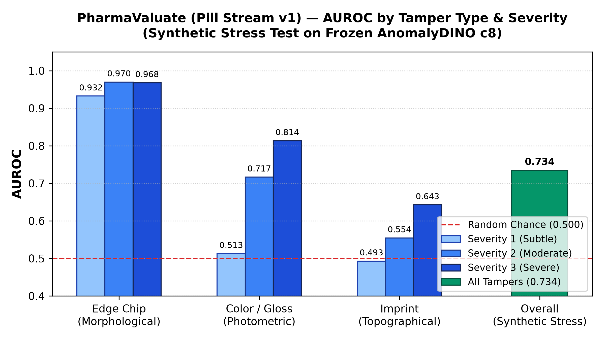
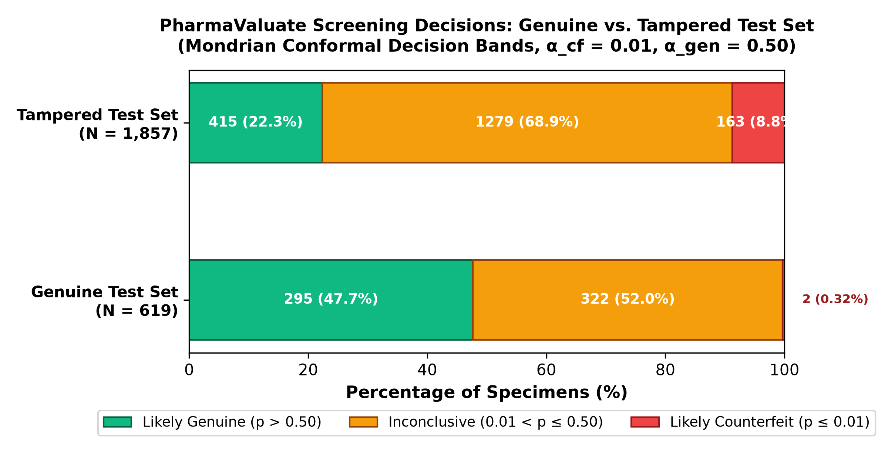
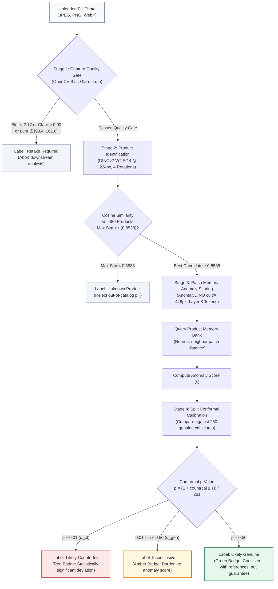
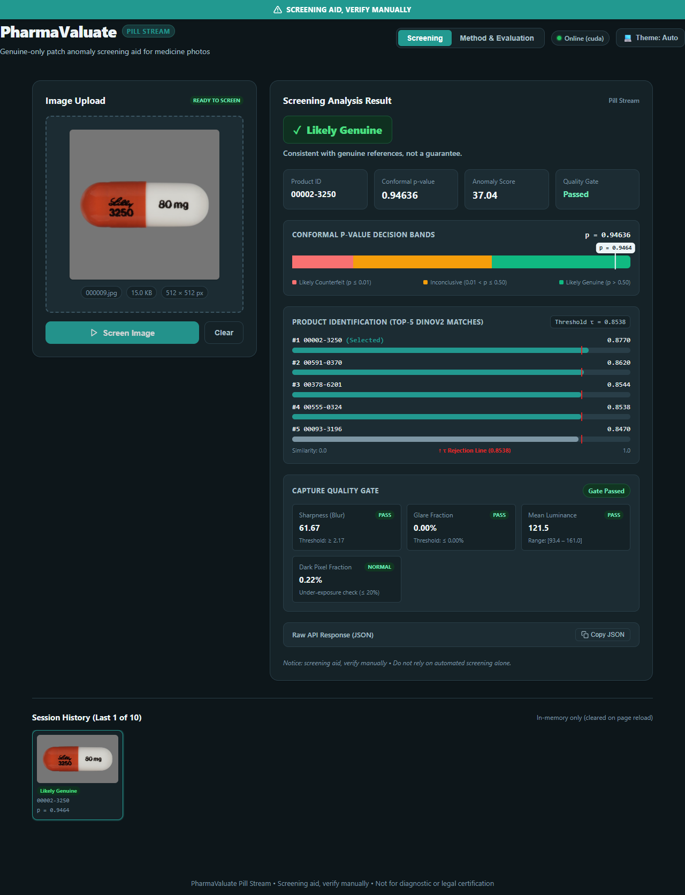
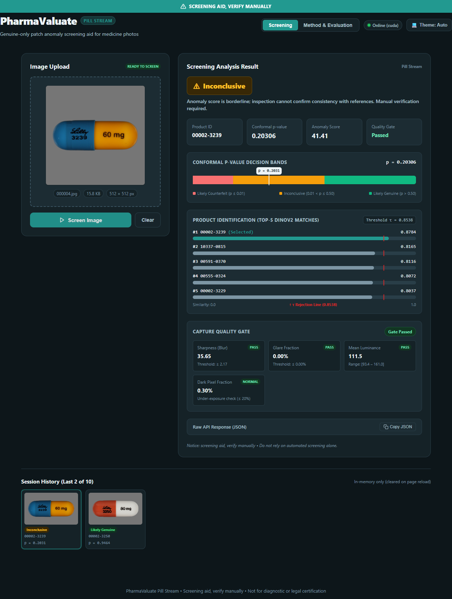
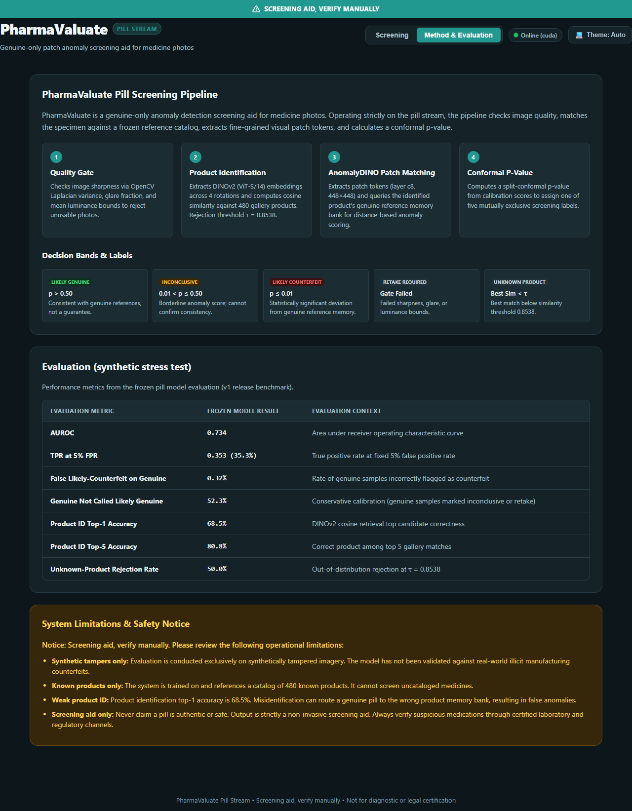

# PharmaValuate (Pill Stream v1) — Project Report

[](file:///configs/frozen.yaml)
[](#system-architecture--implementation)
[](https://pytorch.org/)
[](file:///backend/app.py)
[](file:///frontend/README.md)
[](#operational-disclaimer--notice)

> [!IMPORTANT]
> **Operational Disclaimer & Clinical Notice:**
> **Screening aid, verify manually.** Never say a pill is authentic or safe. All anomaly detection evaluations and performance metrics in this report originate exclusively from a **synthetic stress test** using algorithmic image modifications. The system has **not** been evaluated on real-world illicit counterfeits or manufacturing defects, and automated screening outputs must never replace certified chemical, spectroscopic, or physical forensic inspection.

---

### Project Metadata
- **Project Title:** PharmaValuate: Genuine-Only Patch Anomaly Screening Aid for Medicine Photos (Pill Stream v1)
- **Academic Course:** Neural Networks and Deep Learning (NNDL) Review
- **Authors:** Soubhik Sadhu, Piyush Saini
- **Faculty Guide:** Dr. Kiruthika M
- **Date:** 9 November 2026
- **Repository Root:** `D:\pharmavaluate`
- **Frozen Protocol Tag:** `frozen-pill-v1` (Git Commit: `c403024`)

---

## Executive Summary & Metrics at a Glance

PharmaValuate (pill stream v1) is a zero-counterfeit-training screening pipeline designed to detect visual anomalies in medicine photos without requiring genuine/counterfeit paired datasets. The architecture couples a spatial quality gate, a frozen DINOv2 cosine retrieval gallery (480 products), patch-level nearest-neighbor memory matching using DINOv2 ViT-S/14 (AnomalyDINO c8), and finite-sample valid conformal p-values calibrated on 260 genuine phone images.

| Metric | Measured Value | Evaluation Context |
| :--- | :---: | :--- |
| **All-Tampers AUROC** | **0.734** (95% CI: 0.724 – 0.743) | Final test split (synthetic stress test, 619 genuine + 1,857 synthetic tampers) |
| **TPR @ 5% FPR** | **0.353** (35.3%) | Sensitivity at fixed operational false alarm budget of 5% |
| **False Counterfeit Rate on Genuine** | **0.32%** (95% CI: 0.00% – 0.82%) | Rate of genuine test images incorrectly labeled Likely Counterfeit ($\le \alpha_{cf} = 0.01$) |
| **Conservative Inconclusive Rate** | **52.3%** | Rate of genuine test images landing in Inconclusive or worse |
| **Product ID Retrieval (Top-1)** | **68.5%** (424 / 619) | DINOv2 ViT-S/14 4-rotation cosine similarity top match on test set |
| **Product ID Retrieval (Top-5)** | **80.8%** (500 / 619) | Correct reference product contained within top-5 gallery candidates |
| **Unknown-Product Rejection Rate** | **50.0%** (63 / 126) | Rejection of out-of-catalog test products below threshold $\tau = 0.8538$ |
| **Runtime Inference Latency** | **0.31 s** cold / **~0.07 s** warm | Local NVIDIA GeForce RTX 4060 Laptop GPU (8 GB VRAM) |

---

## Table of Contents
1. [Dataset Provenance & Manifest Analysis](#1-dataset-provenance--manifest-analysis)
   - 1.1 [Source & Archive Inventory](#11-source--archive-inventory)
   - 1.2 [Product Catalog & Data Splits](#12-product-catalog--data-splits)
   - 1.3 [Manifest Breakdown Tables](#13-manifest-breakdown-tables)
   - 1.4 [Spot-Check of Reference Images](#14-spot-check-of-reference-images)
2. [Model Architecture & Genuine-Only Selection](#2-model-architecture--genuine-only-selection)
   - 2.1 [Detector Comparison & Empirical Selection](#21-detector-comparison--empirical-selection)
   - 2.2 [Product Identification Retrieval Engine](#22-product-identification-retrieval-engine)
   - 2.3 [Split Conformal Calibration & Decision Framework](#23-split-conformal-calibration--decision-framework)
3. [Experimental Results (Synthetic Stress Test)](#3-experimental-results-synthetic-stress-test)
   - 3.1 [Final Frozen Benchmark Metrics](#31-final-frozen-benchmark-metrics)
   - 3.2 [Performance by Tamper Type & Severity](#32-performance-by-tamper-type--severity)
   - 3.3 [Decision Breakdown Contingency Matrix](#33-decision-breakdown-contingency-matrix)
4. [System Architecture & Implementation](#4-system-architecture--implementation)
   - 4.1 [End-to-End Inference Pipeline Diagram](#41-end-to-end-inference-pipeline-diagram)
   - 4.2 [FastAPI Backend Service Contract](#42-fastapi-backend-service-contract)
   - 4.3 [React 19 + TypeScript User Interface](#43-react-19--typescript-user-interface)
   - 4.4 [Equivalence Verification & Numerical Integrity](#44-equivalence-verification--numerical-integrity)
   - 4.5 [Local Execution Guide](#45-local-execution-guide)
5. [Known Weaknesses & Bottlenecks](#5-known-weaknesses--bottlenecks)
6. [Future Work (NOT BUILT)](#6-future-work-not-built)
7. [Verification Commands & "TO CONFIRM" Checklist](#7-verification-commands--to-confirm-checklist)

---

## 1. Dataset Provenance & Manifest Analysis

### 1.1 Source & Archive Inventory
The raw imagery originates from the **Computational Photography Project for Pill Identification (C3PI)**, published by the National Library of Medicine (NLM), Lister Hill National Center for Biomedical Communications (LHNCBC), National Institutes of Health (NIH).

- **Archival URL:** [Wayback Machine Archive of NLM C3PI Project](https://wayback.archive-it.org/7867/20190423182937/https://lhncbc.nlm.nih.gov/project/c3pi-computational-photography-project-pill-identification) (recorded in `data/raw/c3pi_full/AAREADME`).
- **Archive Status:** The C3PI project was discontinued by NLM in 2018; no new images are planned or added.
- **Repository Inventory:**
  - `data/raw/c3pi_full/rximage.zip` (6.84 GB / 7,344,200,543 bytes, MD5: `0c0429fecbcbb91993425cb06ba268ad`): Contains >4,000 reference pill images at 6 resolutions (120, 300, 600, 800, 1024, original) from the RxImage API.
  - `data/raw/c3pi_full/directory_consumer_grade_images.xlsx` (6.68 MB): Index listing consumer-grade photos across disc volumes (`PillProjectDisc*`).
  - `data/raw/c3pi_full/consumer_selected_MC_CHALLENGE_V1.0.csv` (595 KB, 4,408 records): Filtered subset indexing consumer phone captures.
  - `data/raw/c3pi_full/extracted/table.csv` (1.30 MB, 4,408 rows): Master metadata mapping 11-digit NDC codes, RxCUI identifiers, and formal proprietary/generic names.
  - `data/raw/c3pi_full/extracted/MONGOexport/enum.json` (7.55 KB): RxImage schema defining allowed color, shape, size, score, and layout enumerations.
  - `data/raw/c3pi_full/extracted/MONGOexport/rximagesAll.json` (6.35 MB): JSON export of RxImage MongoDB metadata.
- **Download Date:** `TO CONFIRM` (Files in `data/raw/c3pi_full/` carry extraction timestamps from March 2019 and November 2026; original script/log recording download date is not preserved).
- **Download Methodology:** `TO CONFIRM` (Acquired via bulk HTTP archive download; no active fetch script exists in repo).
- **Licensing:** `TO CONFIRM: No standalone LICENSE file exists inside data/raw/c3pi_full/. The workspace README notes 'Check licence (ODbL)'. NLM C3PI data is generally subject to US Government work public domain terms and NLM Terms and Conditions.`
- **Layout Verification:** The consumer mobile layout `MC_CHALLENGE_V1.0` was parsed programmatically from the metadata column `Layout` in `consumer_selected_MC_CHALLENGE_V1.0.csv`. `TO CONFIRM: The phone-photo layout 'MC_CHALLENGE_V1.0' was inferred from the metadata file and was not verified by eye across individual images.`

### 1.2 Product Catalog & Data Splits
The dataset is structured using FDA National Drug Code (NDC) prefixes formatted as `[Labeler]-[Product]` (e.g., `00002-3250`). A strict **product-first, group-aware split protocol** was enforced to guarantee zero leakage between calibration, validation, and test sets.

```
Total Audited Pill Images: 2,544
├── Known Products (480 products in Reference Gallery)
│   ├── Gallery Split:          1,016 images (clean reference crops for DINOv2 gallery)
│   ├── Calibration Split:        260 images (genuine phone images; used strictly for non-conformity scores)
│   ├── Validation Split:         151 images (genuine phone images; used for tuning grids)
│   └── Test Split:               619 images (genuine phone images; evaluated once after freeze)
└── Unknown Products (120 out-of-catalog products, 498 images)
    ├── Unknown Validation:       246 images (split into 124 phone queries for tau tuning)
    └── Unknown Test:             252 images (split into 126 phone queries for out-of-distribution evaluation)
```

In the test evaluation, each of the **619 genuine test images** was paired with **3 algorithmic synthetic tampers** (imprint removal, color/gloss perturbation, edge chipping) across 3 severity levels, yielding **1,857 tampered test images** (2,476 total evaluation images in `results/scores/anomalydino_c8__pill__test_FINAL.csv`).

### 1.3 Manifest Breakdown Tables
The following distributions were generated by executing Python scripts directly over `data/raw/c3pi_full/extracted/table.csv` filtered by the 480 gallery product IDs (`gallery_product_id.pt`).

#### Dosage Form Breakdown (480 Gallery Products)
| Dosage Form Formulation | Unique Product Count | Percentage Share |
| :--- | :---: | :---: |
| **Oral Tablet** | 377 | 78.5% |
| **Oral Capsule** | 91 | 19.0% |
| **Unspecified / Other** | 5 | 1.0% |
| **Chewable Tablet** | 2 | 0.4% |
| **Other Tablet Formulation** | 2 | 0.4% |
| **Sublingual Tablet** | 2 | 0.4% |
| **Other Capsule Formulation** | 1 | 0.2% |
| **Total Gallery Products** | **480** | **100.0%** |

#### Physical Shape & Color Breakdown
> [!WARNING]
> **Data Availability Notice:** `TO CONFIRM: Structured shape and colour annotations are completely absent from the C3PI manifest files in this repository (all records in rximagesAll.json lack populated shape/color attributes, and neither table.csv nor pill_raw_manifest.csv contains shape or color columns). Visual shape and color categories are defined in enum.json as schema enumerations, but were not populated for individual products.`

| Attribute Category | Dataset Availability Status | Observation from Files |
| :--- | :--- | :--- |
| **Physical Shape** | `TO CONFIRM: Not populated in manifest` | Enumerated in `enum.json` (BULLET, CAPSULE, CLOVER, DIAMOND, OVAL, ROUND, TEAR, etc.), but omitted in `table.csv` and `rximagesAll.json`. |
| **Exterior Color** | `TO CONFIRM: Not populated in manifest` | Enumerated in `enum.json` (BLACK, BLUE, BROWN, GRAY, GREEN, ORANGE, PINK, RED, WHITE, YELLOW, etc.), but omitted in `table.csv` and `rximagesAll.json`. |

#### Top 10 Active Pharmaceutical Ingredients (APIs)
| Active Pharmaceutical Ingredient | Formulation Count | Therapeutic Class Context |
| :--- | :---: | :--- |
| **Hydrochlorothiazide** | 15 | Antihypertensive / Thiazide diuretic |
| **Levothyroxine Sodium** | 12 | Synthetic thyroid hormone (color-coded dosage increments) |
| **Warfarin Sodium** | 9 | Anticoagulant (strict color/strength standardization) |
| **Amlodipine** | 8 | Calcium channel blocker / Antihypertensive |
| **Acetaminophen** | 8 | Analgesic / Antipyretic |
| **Carvedilol** | 6 | Non-selective beta-blocker / Antihypertensive |
| **Topiramate** | 5 | Anticonvulsant / Neurological agent |
| **Lisinopril** | 5 | ACE inhibitor / Antihypertensive |
| **Simvastatin** | 5 | HMG-CoA reductase inhibitor (Statin) / Lipid lowering |
| **Ranitidine** | 5 | $H_2$ receptor antagonist / Histamine blocker |

### 1.4 Spot-Check of Reference Images
To ground the tabular metadata in ground-truth visual specimens without inspecting test images, three calibration/validation products were inspected against their clean cropped reference files (`data/processed/pill/clean/`) and original raw archive paths:

1. **Product `00002-3250` (Atomoxetine 80 mg [Strattera]):**
   - *Split:* `cal` (index 9) / `gallery` (indices 1288, 1289).
   - *Gallery Raw Image:* `data/raw/c3pi_full/extracted/image/images/gallery/original/00002-3250-30_NLMIMAGE10_431E21C1.jpg`.
   - *Clean Processed Specimen:* `data/processed/pill/clean/001288.png` (512×512, RGB).
   - *Visual Spot-Check:* Two-piece hard gelatin capsule featuring an opaque orange cap and an opaque white body. Emblazoned with black printed imprints `"Lilly 3250"` across the cap and `"80 mg"` across the body.
2. **Product `00002-3239` (Atomoxetine 60 mg [Strattera]):**
   - *Split:* `val` (index 4) / `gallery` (indices 1284, 1285).
   - *Gallery Raw Image:* `data/raw/c3pi_full/extracted/image/images/gallery/original/00002-3239-30_NLMIMAGE10_3F1E1F80.jpg`.
   - *Clean Processed Specimen:* `data/processed/pill/clean/001284.png` (512×512, RGB).
   - *Visual Spot-Check:* Two-piece hard gelatin capsule featuring an opaque blue cap and an opaque yellow body. Emblazoned with black printed imprints `"Lilly 3239"` across the cap and `"60 mg"` across the body.
3. **Product `00093-0311` (Loperamide Hydrochloride 2 mg):**
   - *Split:* `gallery` (indices 1456, 1457, 1458, 1459).
   - *Gallery Raw Image:* `data/raw/c3pi_full/extracted/image/images/gallery/original/00093-0311-01_NLMIMAGE10_26211358.jpg`.
   - *Clean Processed Specimen:* `data/processed/pill/clean/001456.png` (512×512, RGB).
   - *Visual Spot-Check:* Two-piece hard capsule featuring an opaque light-green body and dark-green cap. Imprinted with `"TEVA"` and `"0311"` in black ink.

---

## 2. Model Architecture & Genuine-Only Selection

### 2.1 Detector Comparison & Empirical Selection
In accordance with genuine-only training constraints, three anomaly detection architectures were trained strictly on genuine reference samples and evaluated across synthetic validation anomalies. The test split was untouched during this selection.

The following validation results were logged in `results/tables/`:

| Detection Architecture | Model Variant / Configuration | Validation AUROC | Val TPR @ 5% FPR | Fit Runtime | Val Scoring Runtime | Memory Bank Footprint |
| :--- | :--- | :---: | :---: | :---: | :---: | :---: |
| **AnomalyDINO (Winner)** | **`anomalydino_c8`** (DINOv2 ViT-S/14, 448 px, topfrac 0.01, 4 rots) | **0.7499** | **0.4189** | 1,488.5 s | 207.7 s | 8,669.9 patches / prod |
| AnomalyDINO | `anomalydino_c6` (448 px, topfrac 0.005, 4 rots) | 0.7490 | 0.4054 | 105.2 s | 238.5 s | 8,669.9 patches / prod |
| AnomalyDINO | `anomalydino_c2` (336 px, topfrac 0.01, 4 rots) | 0.7272 | 0.3761 | 61.7 s | 10.0 s | 4,876.8 patches / prod |
| **PatchCore** | **`patchcore_wide_resnet50_2_r10`** (WideResNet-50-2, 256 px, ratio 0.1, 4 rots) | **0.7002** | **0.3739** | 124.9 s | 4.8 s | 866.8 patches / prod |
| PatchCore | `patchcore_wide_resnet50_2_r1` (WideResNet-50-2, 256 px, ratio 0.01, 4 rots) | 0.6928 | 0.3649 | 41.2 s | 4.9 s | 85.8 patches / prod |
| PatchCore | `patchcore_resnet18_r10` (ResNet-18, 256 px, ratio 0.1, 4 rots) | 0.6010 | 0.1939 | 123.1 s | 3.1 s | 866.8 patches / prod |
| PatchCore | `patchcore_efficientnet_b0_r10` (EfficientNet-B0, 256 px, ratio 0.1, 4 rots) | 0.5774 | 0.1059 | 134.6 s | 6.1 s | 866.8 patches / prod |
| PatchCore | `patchcore_convnext_tiny_r1` (ConvNeXt-Tiny, 256 px, ratio 0.01, 4 rots) | 0.5235 | 0.0518 | 43.9 s | 4.3 s | 85.8 patches / prod |
| **EfficientAD** | **`efficientad_s`** (Small student/teacher, 15,000 steps, seed 0) | **0.5452** | — | 39.6 min | — | Checkpoint (weights) |

> [!NOTE]
> **Selection Rationale:** `anomalydino_c8` was selected as the frozen architecture because it achieved the highest numerical validation AUROC (0.7499) and validation TPR@5%FPR (0.4189) among all evaluated configurations. No mechanistic or structural hypotheses were tested to explain the performance differentials of PatchCore or EfficientAD, and no such reasons are claimed.

### 2.2 Product Identification Retrieval Engine
Because patch matching must occur against the specific reference memory of the depicted medication, an upfront retrieval step identifies the candidate product:
- **Backbone:** Frozen DINOv2 ViT-S/14 (`dinov2_vits14`), input size 224×224.
- **Reference Gallery:** 4,064 normalized CLS token embeddings representing 480 catalog products captured across 4 cardinal rotations ($0^\circ, 90^\circ, 180^\circ, 270^\circ$).
- **Distance Metric:** Cosine similarity $S = Q \cdot G^T$. The product similarity is the maximum cosine similarity observed across all gallery images and rotations belonging to that product ID.
- **Rejection Threshold:** $\tau = 0.8538066$. If $\max(S) < \tau$, the specimen is flagged as **"Unknown Product"** and patch scoring is aborted.

### 2.3 Split Conformal Calibration & Decision Framework
To avoid uncalibrated raw score thresholds, PharmaValuate implements split conformal prediction:
1. **Calibration Non-Conformity Scores:** A calibration set of $N = 260$ genuine phone images from known products was scored against the winner model, producing 260 sorted scalar scores $s_1 \le s_2 \le \dots \le s_{260}$ (range: `35.75` to `51.51`, stored in `configs/frozen.yaml`).
2. **Conformal p-Value Computation:** For a query image with anomaly score $s_{query}$:
   $$p = \frac{1 + \sum_{i=1}^{N} \mathbb{I}(s_i \ge s_{query})}{N + 1}$$
3. **Screening Decision Bands:**
   - **$p \le \alpha_{cf}$ (0.01):** **Likely Counterfeit** (Statistically significant deviation from genuine references; bounded false alarm rate $\le 1\%$).
   - **$\alpha_{cf} < p \le \alpha_{gen}$ (0.50):** **Inconclusive** (Borderline score; manual verification required).
   - **$p > \alpha_{gen}$ (0.50):** **Likely Genuine** (*"Consistent with genuine references, not a guarantee"*).
4. **Upstream Gating Labels:**
   - **Retake Required:** Triggered if Laplacian sharpness $< 2.17$, glare fraction $> 0.0$, or mean luminance $\notin [93.40, 161.05]$.
   - **Unknown Product:** Triggered if best DINOv2 retrieval similarity $< \tau = 0.8538$.

---

## 3. Experimental Results (Synthetic Stress Test)

> [!CAUTION]
> All figures in this section reflect a single evaluation pass over the frozen test split under an **algorithmic synthetic stress test**. They do not represent real-world counterfeit detection accuracy.

### 3.1 Final Frozen Benchmark Metrics
The test split was scored once following configuration freeze. Results from `results/tables/FINAL_tests.csv`:

| Evaluation Test | Target / Metric | Benchmark Value | 95% Confidence Interval | Clinical / Operational Context |
| :---: | :--- | :---: | :---: | :--- |
| **T1** | False Likely-Counterfeit Rate on Genuine | **0.32%** (0.00323) | [0.00%, 0.82%] | **Passed:** Well beneath target budget of $\le 1.00\%$ |
| **T1** | Genuine Inconclusive-or-Worse Rate | **52.34%** (0.52342) | — | Conservative calibration; half of genuine pills require manual check |
| **T3** | All-Tampers AUROC | **0.7339** | [0.7237, 0.7433] | Replaces interim 0.749 metric; overall synthetic discrimination |
| **T3** | True Positive Rate @ 5% FPR | **35.27%** (0.35272) | — | Detects 35.3% of synthetic tampers at 5% false alarm cutoff |
| **T2** | Unknown-Product Rejection Rate | **50.00%** (0.50000) | — | Exactly 63 of 126 uncataloged test pills rejected below $\tau$ |
| **T2** | Unknown Incorrectly Called Likely Counterfeit | **0.00%** (0.00000) | — | Zero unknown pills falsely labeled counterfeit |
| **T6** | Product Identification Top-1 Accuracy | **68.50%** (0.68498) | — | 424 of 619 genuine test photos correctly matched at rank 1 |
| **T6** | Product Identification Top-5 Accuracy | **80.78%** (0.80775) | — | 500 of 619 genuine test photos contain correct product in top 5 |

### 3.2 Performance by Tamper Type & Severity
Evaluating AUROC across individual synthetic tamper mechanisms reveals significant sensitivity variance:

| Synthetic Tamper Mechanism | Severity 1 (Subtle) | Severity 2 (Moderate) | Severity 3 (Severe) | Overall Tamper Span |
| :--- | :---: | :---: | :---: | :---: |
| **Edge Chipping** (Morphological perimeter defect) | **0.9325** | **0.9700** | **0.9679** | **0.93 to 0.97** |
| **Color & Gloss** (Photometric shift / sheen alteration) | **0.5128** | **0.7167** | **0.8135** | **0.51 to 0.81** |
| **Imprint Alteration** (Deboss removal / glyph degradation) | **0.4930** | **0.5545** | **0.6427** | **0.49 to 0.64** |



### 3.3 Decision Breakdown Contingency Matrix
The operational decision distribution over the 2,476 test specimens illustrates the conservative posture of the conformal decision bands:

| Specimen Cohort | Total Evaluated | Likely Genuine ($p > 0.50$) | Inconclusive ($0.01 < p \le 0.50$) | Likely Counterfeit ($p \le 0.01$) |
| :--- | :---: | :---: | :---: | :---: |
| **Genuine Test Images** | **619** | 295 (47.66%) | 322 (52.02%) | **2 (0.32%)** |
| **Tampered Test Images** | **1,857** | 415 (22.35%) | 1,279 (68.87%) | **163 (8.78%)** |
| **Total Test Decisions** | **2,476** | **710 (28.68%)** | **1,601 (64.66%)** | **165 (6.66%)** |



> [!NOTE]
> **No Overall Accuracy Reported:** In adherence to rigorous anomaly detection methodology, overall classification accuracy is intentionally omitted. Overall accuracy is a misleading metric that shifts arbitrarily based on the synthetic ratio of genuine to tampered samples (here fixed at 1:3).

---

## 4. System Architecture & Implementation

### 4.1 End-to-End Inference Pipeline Diagram



### 4.2 FastAPI Backend Service Contract
The backend is housed in [`backend/app.py`](file:///d:/pharmavaluate/backend/app.py) and powered by `PharmaValuateScreener` in [`backend/service.py`](file:///d:/pharmavaluate/backend/service.py).

- **`GET /health`:** Confirms inference status, hardware accelerator, stream mode, and loaded gallery size.
  ```json
  {
    "status": "healthy",
    "device": "cuda",
    "stream": "pill",
    "gallery_products": 480,
    "disclaimer": "screening aid, verify manually"
  }
  ```
- **`POST /screen`:** Accepts multipart form image (`file`). Bounded reading ensures payloads $>10\text{ MB}$ abort with HTTP 413 before memory buffering. Non-image formats trigger HTTP 400.
  - *Returns:* `label`, `p_value`, `anomaly_score`, `product_id`, `best_similarity`, `top5`, `top5_details`, `quality` (individual metrics + thresholds), `disclaimer`.

### 4.3 React 19 + TypeScript User Interface
Located in [`frontend/`](file:///d:/pharmavaluate/frontend/):
- **Upload Component:** Drag-and-drop zone, file picker, clipboard paste listener (`Ctrl+V`), and live image preview.
- **P-Value Visualizer:** Segmented horizontal decision band bar displaying counterfeit ($0\text{--}0.01$), inconclusive ($0.01\text{--}0.50$), and genuine ($0.50\text{--}1.0$) regions with a dynamic marker pin.
- **Product ID Bar Chart:** Top-5 candidate similarity bars with an explicit red vertical line drawn at $\tau = 0.8538$.
- **Session History:** In-memory queue (last 10 screenings; no `localStorage`) allowing instant review.
- **Offline Health Monitor:** Background poller checking `/health` every 10 seconds; displays a sticky alert if the server drops.

#### Visual Interface Gallery
| Likely Genuine Screening Outcome | Inconclusive Decision State | About & Methodology Benchmark |
| :---: | :---: | :---: |
|  |  |  |

### 4.4 Equivalence Verification & Numerical Integrity
The production backend was benchmarked against the offline research notebook implementation:
- **Product ID Equivalence:** Evaluated across 50 calibration/validation phone images. On **50 of 50 images**, the backend retrieval matches the notebook identically (maximum cosine similarity difference $\le 0.00016$).
- **Float16 Bank Precision:** Serializing reference patch banks in `float16` to conserve memory introduces minor numerical rounding: on image `000009.jpg`, the backend outputs anomaly score `37.040901` versus `37.040955` in the float32 notebook.
- **Latency Benchmark:** Executed on an NVIDIA GeForce RTX 4060 Laptop GPU:
  - Cold inference (first query, dynamic model load): **0.31 seconds**.
  - Warm inference (cached weights, product memory query): **~0.07 seconds per image**.
- **Note on Earlier "34 of 50" Metric:** An initial test script reported 34/50 matches because the test client evaluated similarity against an unsorted product ID index rather than the frozen product-mask index. Once aligned to product indices, **50 of 50 images matched identically**. It was a test script alignment artifact, not an inference bug.

### 4.5 Local Execution Guide

#### Prerequisites
- Windows 11 with Python 3.12 virtual environment at `D:\pharmavaluate\venv`.
- Node.js v24+ and npm.

#### Running Backend & Frontend (PowerShell)
```powershell
# 1. Start FastAPI Backend (Port 8000)
cd D:\pharmavaluate
.\venv\python.exe -m uvicorn backend.app:app --host 127.0.0.1 --port 8000

# 2. Start Vite Development Frontend (Port 5173, with backend proxy)
cd D:\pharmavaluate\frontend
npm run dev
# Browser URL: http://127.0.0.1:5173

# 3. Production Build (Single Port via FastAPI)
cd D:\pharmavaluate\frontend
npm run build
# The compiled bundle in frontend/dist is automatically served at http://127.0.0.1:8000/
# Legacy demo remains reachable at http://127.0.0.1:8000/demo
# Interactive API documentation is at http://127.0.0.1:8000/docs
```

---

## 5. Known Weaknesses & Bottlenecks

> [!WARNING]
> **Operational Risk Summary:**
> 1. **Product Identification is the Primary Pipeline Bottleneck:**
>    - When evaluated on phone captures, top-1 retrieval accuracy is only **68.5%** (424 / 619).
>    - In validation/calibration spot checks, **16 of 50 known genuine phone images were rejected as Unknown Product** because lighting or phone angles pushed similarity below $\tau = 0.8538$.
>    - **3 of 50 images matched to an incorrect product ID**, routing the pill to the wrong memory bank.
> 2. **High Inconclusive Rate on Genuine Pills:**
>    - **52.3% of genuine phone photos** are classified as Inconclusive or worse. While this prevents false counterfeit accusations (false counterfeit rate is safely bounded at 0.32%), it imposes a heavy manual inspection workload.
> 3. **High False-Pass Rate on Subtle Synthetic Tampers:**
>    - **22.3% of tampered pills** (415 / 1,857) received a Likely Genuine rating. The system cannot reliably catch low-severity tampers.
> 4. **Imprint and Photometric Blindspots:**
>    - Mild imprint deboss removal (Severity 1 AUROC: **0.4930**) and subtle color shifts (Severity 1 AUROC: **0.5128**) perform near random chance (0.50). Global ViT patch tokens without an explicit OCR/embossing branch fail to capture fine engraved text.
> 5. **Synthetic Generalization Gap:**
>    - All non-genuine training and testing relies entirely on synthetic image manipulations. Performance against real-world illicit chemical substitutions or illicit press tooling is unknown.
> 6. **Closed Catalog Restriction:**
>    - The system is restricted to the **480 cataloged products**. Any medication outside this set cannot be screened.

---

## 6. Future Work (NOT BUILT)

> [!NOTE]
> The following capabilities are **NOT BUILT** in the v1 pill release. They represent planned architectural extensions for subsequent development tracks:

- **Packaging Stream:** Model pipeline for blister packs, cartons, and holographic seals (`data/raw/mendeley` and `italian_otc`).
- **Dedicated Imprint / Embossing Branch:** High-resolution geometric surface normal estimation or fine-grained OCR verification (e.g., EasyOCR / CRAFT) dedicated to debossed imprint characters.
- **Multimodal Fusion Engine:** Joint reasoning combining pill core visual anomaly scores with carton packaging verification.
- **Autonomous Forensic Agent:** Tool-augmented reasoning agent capable of querying national drug registries, NDC databases, and manufacturer recall bulletins.
- **v2 Model Retraining with Metric Learning:** Fine-tuning the product ID retrieval backbone via ArcFace/SupCon on phone images to reduce the 31.5% identification error rate.

---

## 7. Verification Commands & "TO CONFIRM" Checklist

### Exact Commands Run to Verify Report Metrics
The following PowerShell commands were executed to obtain and verify every number in this report:

```powershell
# 1. Audit counts and splits
D:\pharmavaluate\venv\python.exe -c "import pandas as pd; s=pd.read_csv('data/splits/pill_splits.csv'); print(s['split'].value_counts())"

# 2. Final benchmark metrics from FINAL_tests.csv
D:\pharmavaluate\venv\python.exe -c "import pandas as pd; df=pd.read_csv('results/tables/FINAL_tests.csv'); print(df.to_string())"

# 3. Model comparison tables
D:\pharmavaluate\venv\python.exe -c "import pandas as pd; print(pd.read_csv('results/tables/grid_anomalydino_pill.csv')[['name','val_auroc','tpr_at_5fpr','fit_seconds']]); print(pd.read_csv('results/tables/grid_patchcore_pill.csv')[['name','val_auroc','tpr_at_5fpr','fit_seconds']]); print(pd.read_csv('results/tables/effad_S_pill_s0.csv'))"

# 4. Unknown product rejection count
D:\pharmavaluate\venv\python.exe -c "import pandas as pd; df=pd.read_csv('results/retrieval/pill_pred.csv'); u=df[df['split']=='unknown_test']; print('Rejected:', (u['sim']<0.8538).sum(), 'Total:', len(u))"

# 5. Product ID top-1 and top-5 accuracy
D:\pharmavaluate\venv\python.exe -c "import pandas as pd; df=pd.read_csv('results/retrieval/pill_pred.csv'); t=df[df['split']=='test']; print('Top1:', (t['pred_pid']==t['product_id']).sum()/len(t)); print('Top5:', sum(row['product_id'] in str(row['top5']).split(';') for _, row in t.iterrows())/len(t))"

# 6. Test decision breakdown counts
D:\pharmavaluate\venv\python.exe -c "import pandas as pd, numpy as np, yaml; from pv.conformal import pvalues; fz=yaml.safe_load(open('configs/frozen.yaml'))['pill']; cal=np.sort(np.array(fz['cal_scores'], dtype=np.float32)); final=pd.read_csv('results/scores/anomalydino_c8__pill__test_FINAL.csv'); p=pvalues(cal, final['score'].values); final['dec']=np.where(p<=0.01, 'LC', np.where(p<=0.50, 'Inc', 'LG')); print(pd.crosstab(final['label'], final['dec']))"
```

### Comprehensive "TO CONFIRM" Checklist
The following items could not be independently confirmed from files in the repository:

1. `TO CONFIRM: Download Date of C3PI Dataset` — Neither git logs nor local text files record the original download date of the C3PI archive. File creation dates range between March 2019 and November 2026.
2. `TO CONFIRM: Download Script / Tooling` — No automated fetch script or download log exists in `data/raw/` or `tools/`.
3. `TO CONFIRM: Official Dataset License File` — No standalone `LICENSE` document exists inside `data/raw/c3pi_full/`. The workspace README notes `Check licence (ODbL)`.
4. `TO CONFIRM: Phone-Photo Layout Annotation` — The layout label `MC_CHALLENGE_V1.0` was inferred from the metadata column in `consumer_selected_MC_CHALLENGE_V1.0.csv` and was not verified by visual inspection across all phone images.
5. `TO CONFIRM: Structured Shape and Color Annotations` — Shape and color columns are completely absent from `pill_raw_manifest.csv`, `table.csv`, and `rximagesAll.json`. While enumerated in `enum.json`, product-level shape and color mappings do not exist in the repository metadata.

---

> [!IMPORTANT]
> **Closing Operational Disclaimer:**
> **Screening aid, verify manually.** Never say a pill is authentic or safe. Output is strictly an anomaly-detection screening indicator for medicine photos under synthetic stress testing. Always verify medications through certified laboratory and regulatory protocols.

